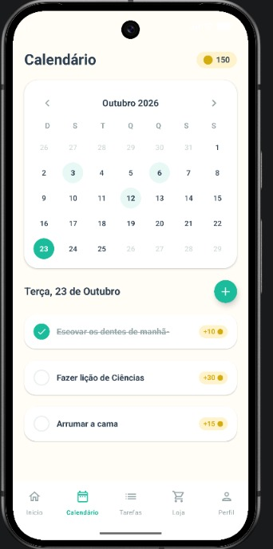
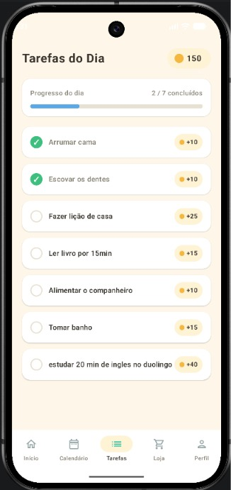
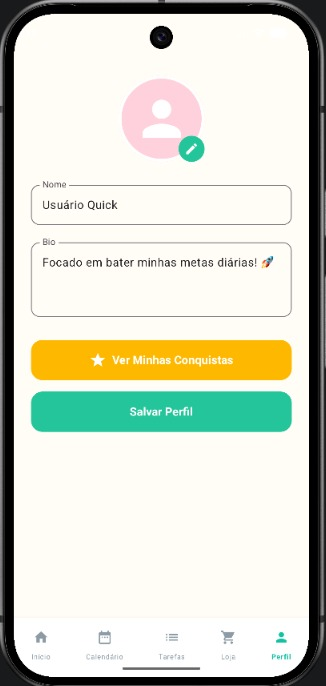
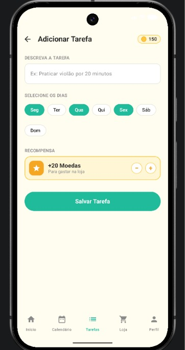

# Quick!

> Aplicativo desenvolvido em Kotlin. O aplicativo Quick! tem o intuito de incentivar que os usuários passem menos tempo
> no celular, e mais tempo se desenvolvendo, tal como estudando e/ou praticando execícios físicos.


## 📋 Sumário

- [Sobre](#-sobre)
- [Funcionalidades](#-funcionalidades)
- [Tecnologias](#-tecnologias)
- [Pré-requisitos](#-pré-requisitos)
- [Como executar](#-como-executar)
- [Estrutura do projeto](#-estrutura-do-projeto)
- [Equipe](#-equipe)

## 📖 Sobre

O aplicativo Quick! tem o objetivo que as pessoas passem menos tempo conectadas e pratiquem mais atividades que antes
costumavam fazer, dessa maneira pensamos que desenvolvendo um aplicativo móvel seria um bom incentivo, pois ao realizar
as tarefas serão obtidas moedas que servirão para personalização do pet e seus cenários. Projeto criado exclusivamente para 
a matéria de Desenvolvimento de Aplicativos Móveis no intuito de ser inovador no que se propoẽ

## 🛸 Documentação do processo e das decisões
1 - Como estava o projeto no Trabalho 2 e o que mudou?
No Trabalho 2, o Quick! guardava os dados só em memória, com mutableStateListOf, então tudo se perdia ao fechar o app. Neste trabalho adicionamos o Room como banco de dados local e implementamos o CRUD completo. Agora tarefas e itens da loja são salvos e lidos do banco, e os dados persistem entre as execuções.

2 - Quais Entity, DAO e Database foram criados, e por que esses campos?

Entities: Task (tarefas da lista) e ItemLoja (itens da loja de moedas).
Campos: Task com id, título, descrição, data, concluída e moedas de recompensa; ItemLoja com id, nome, preço e imagem. Escolhemos esses campos porque são os dados que as telas de adicionar tarefa, tarefas do dia e loja precisam exibir e salvar.
DAOs: TaskDao e ItemLojaDao fazem as operações de inserir, atualizar, remover e consultar no banco.
AppDatabase: é a classe que configura o Room, registra as entidades e fornece o acesso aos DAOs. 

3 - Como estruturaram as queries do DAO?
Cada entidade tem seu próprio DAO: TaskDao para as tarefas e ItemLojaDao para a loja. Ambos têm as 4 operações do CRUD (@Insert, @Update, @Delete e uma @Query que lista tudo Todos os métodos são suspend, para não bloquear a thread principal.

4 - Qual foi a dificuldade em migrar de mutableStateListOf para Room?
A migração foi tranquila, sem grandes problemas. A principal dificuldade foi adaptar as telas, que antes liam uma lista em memória e agora precisam buscar os dados do banco, também a implementação do CRUD foi problemática pois o celular do android studio não deixava a gente testar direito

5 - Alguém do trio teve dificuldade? Como resolveram?
Sim, tivemos várias. A principal foi o tempo, de novo, porque o prazo apertou. Outra foram as diferentes versões do Android Studio entre os integrantes, que causavam conflitos de build e de dependências.

## ✨ Funcionalidades

- [x] Tela de perfil
- [x] Tela de conquistas
- [x] Tela de listas de tarefas a fazer e concluídas
- [x] Tela de Loja
- [x] Tela de calendário
- [x] Tela principal com pet
- [x] Tela de adicionar tarefas

## 🛠 Tecnologias

- [Kotlin](https://kotlinlang.org/)
- [Gradle (Kotlin DSL)](https://gradle.org/)
- [Android Studio](https://developer.android.com/studio)

## ✅ Pré-requisitos

- [Android Studio](https://developer.android.com/studio) instalado
- JDK compatível com a versão do Gradle do projeto
- Um emulador Android configurado ou um celular com depuração USB ativada

## 🚀 Como executar

```bash
# Clone o repositório
git clone https://github.com/SophiLombardi/quick-.git

# Entre na pasta
cd quick-
```

1. Abra o projeto no **Android Studio** (`File > Open` e selecione a pasta do projeto).
2. Aguarde o Gradle sincronizar as dependências.
3. Escolha um emulador ou dispositivo e clique em **Run ▶**.

Também é possível compilar pelo terminal:

```bash
# Linux / macOS
./gradlew assembleDebug

# Windows
gradlew.bat assembleDebug
```

## 📁 Estrutura do projeto

```
quick-/
├── app/                    # Código-fonte do aplicativo
├── gradle/                 # Configurações do Gradle wrapper
├── build.gradle.kts        # Configuração de build do projeto
├── settings.gradle.kts     # Módulos do projeto
├── gradle.properties       # Propriedades do Gradle
├── gradlew / gradlew.bat   # Gradle wrapper (Linux/macOS e Windows)
└── README.md
```

## 📸 Imagens









## 👥 Equipe

- [@SophiLombardi](https://github.com/SophiLombardi)
- [@VictEES](https://github.com/VictEES)
- [@Rafazola](https://github.com/Rafazola)
